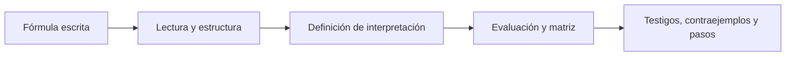

# Evaluador semántico de lógica de primer orden
## Miembros
- Oscar Rompich - 24880
- Arturo Lima - 24683

## Introduccion
Aplicación educativa e interactiva para explorar cómo se analizan y evalúan fórmulas de lógica de primer orden sobre interpretaciones finitas. Acompaña todo el recorrido de forma visual: desde que se escribe la fórmula hasta que se construye la tabla de verdad y se resaltan los testigos o contraejemplos que justifican el resultado.

<table align="center" cellpadding="12">
  <tr>
    <td align="center" bgcolor="#ffffff">
      <a href="https://logic.rompich.me">
        
      </a>
    </td>
  </tr>
</table>
<p align="center"><a href="https://logic.rompich.me"><strong>logic.rompich.me</strong></a></p>

## Cómo está organizado el proyecto

El proyecto separa por completo la **lógica matemática** de la **interfaz visual**. De este modo, las reglas de la lógica se pueden leer, probar y reutilizar de forma independiente a React.



```text
src/
├── features/semantic-evaluator/
│   ├── algorithms/       # Corazón lógico y matemático (independiente de React)
│   ├── components/       # Pizarras interactivas: entrada, árbol, modelo y matriz
│   ├── hooks/            # Conexión entre los algoritmos y la interfaz
│   ├── localization/     # Mensajes y explicaciones del dominio lógico
│   └── data/             # Ejercicios de ejemplo precargados
├── components/layout/    # Barra de navegación y controles de lienzo
├── pages/                # Pantallas principales
├── store/                # Estado global de la sesión (Zustand)
├── i18n/                 # Soporte para español e inglés
└── styles/               # Estilos y temas visuales (claro / oscuro)
```

---

## Mapa de algoritmos

Para revisar cómo está implementada cada parte del razonamiento lógico, todos los módulos viven en [`src/features/semantic-evaluator/algorithms/`](src/features/semantic-evaluator/algorithms):

### 1. Lectura y comprensión de la fórmula
* **[`lexer.ts`](src/features/semantic-evaluator/algorithms/lexer.ts)** — Lee el texto ingresado y lo divide en piezas básicas (símbolos, nombres, paréntesis). También traduce atajos de teclado como `->`, `!` o `\forall` a su notación matemática formal (`→`, `¬`, `∀`).
* **[`lexer-steps.ts`](src/features/semantic-evaluator/algorithms/lexer-steps.ts)** — Realiza la misma lectura, pero guarda cada fragmento paso a paso para poder mostrarle al usuario cómo se reconoce la entrada.
* **[`parser.ts`](src/features/semantic-evaluator/algorithms/parser.ts)** — Verifica que la fórmula esté bien escrita y organiza su jerarquía. También controla el alcance de cada variable y evita que un mismo nombre se use con dos roles distintos a la vez.
* **[`parser-steps.ts`](src/features/semantic-evaluator/algorithms/parser-steps.ts)** — Registra las decisiones que toma el analizador en cada paso para explicar cómo se va armando la estructura de la fórmula.
* **[`parser-tree.ts`](src/features/semantic-evaluator/algorithms/parser-tree.ts)** — Construye el árbol visual de la fórmula de manera progresiva, diferenciando conectivos, cuantificadores, funciones, constantes y variables libres o ligadas.
* **[`parse-errors.ts`](src/features/semantic-evaluator/algorithms/parse-errors.ts)** — Catálogo de errores de escritura (paréntesis sin cerrar, comas faltantes, cuantificadores sin cuerpo) separados de los textos de la interfaz.

### 2. Extracción de símbolos e interpretación
* **[`interpretation.ts`](src/features/semantic-evaluator/algorithms/interpretation.ts)** — Inspecciona la fórmula para descubrir qué elementos necesita definir el usuario en la interpretación (constantes, variables libres en el entorno `ℓ`, funciones y predicados con su cantidad de argumentos) y prepara las combinaciones de entrada para las funciones.

### 3. Evaluación, matriz y búsqueda de evidencia
* **[`evaluation.ts`](src/features/semantic-evaluator/algorithms/evaluation.ts)** — Evalúa la fórmula sobre el modelo elegido. Resuelve conflictos cuando dos cuantificadores reutilizan el mismo nombre de variable, respeta los valores fijados en el entorno `ℓ`, llena la matriz de verdad y selecciona las celdas mínimas que sirven como **testigo** o **contraejemplo**.
* **[`explanation.ts`](src/features/semantic-evaluator/algorithms/explanation.ts)** — Construye el resumen lógico del veredicto final, quedándose únicamente con las ramas y ejemplos decisivos que determinaron si la fórmula es verdadera o falsa.
* **[`truth.ts`](src/features/semantic-evaluator/algorithms/truth.ts)** — Genera el desglose paso a paso al hacer clic sobre una celda específica de la matriz, mostrando cómo se calculan primero las funciones, luego los predicados y finalmente los conectivos.

---

## Recorrido en la interfaz

1. **Entrada:** escribe la fórmula y observa cómo se reconocen sus símbolos y su árbol sintáctico.
2. **Interpretación:** define el dominio $\mathcal{D}$, el significado de constantes, funciones y predicados, y el entorno $\ell$ para las variables libres.
3. **Evaluación:** explora la matriz de combinaciones, inspecciona el cálculo de cualquier celda individual y revisa la evidencia marcada para la conclusión ($\mathcal{I} \models_\ell \varphi$ o $\mathcal{I} \nvDash_\ell \varphi$).

---

## Ejecución local

Requisitos: **Node.js 24** y **pnpm** (habilitado vía Corepack).

```bash
corepack enable
pnpm install --frozen-lockfile
pnpm dev
```

| Tarea | Comando |
| :--- | :--- |
| **Ejecutar pruebas de los algoritmos** | `node --test tests/evaluation.test.mjs` |
| **Compilar versión web** | `pnpm build` |
| **Ejecutar aplicación de escritorio (Tauri)** | `pnpm tauri dev` |
| **Levantar con Docker** (`localhost:3000`) | `docker compose up --build` |

## Evidencia de funcionamiento del programa
<p align="center">
  
  
  
  
</p>


